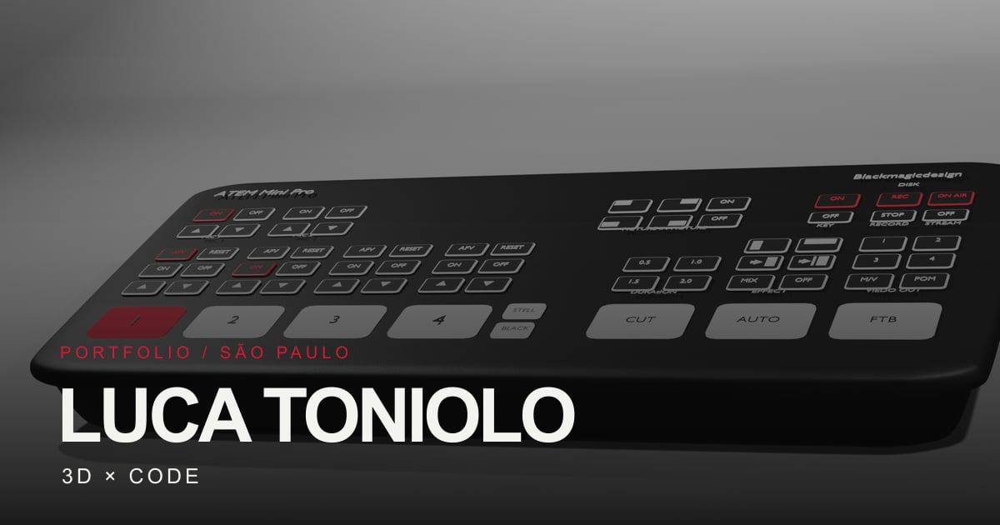

# Luca Toniolo — 3D × Code Portfolio

My portfolio brings together 3D modeling, front-end development, and digital
design. It presents selected work, project details, skills, background, and
contact information.

**Live website:** [luca-toniolo.vercel.app](https://luca-toniolo.vercel.app)



## About the project

The site is a responsive single-page application built with React and Vite. React
Router powers the work index, 3D and programming galleries, and individual
project pages. A loading screen introduces the site; the home page includes
selected work, skills, an about section, and a contact form.

Project pages can include a description, status, tools, case-study notes, image
galleries with thumbnail and previous/next controls, videos, source repositories,
or an interactive prototype. Gallery images are displayed in the page and do not
open a zoom viewer.

The contact form uses Getform. Vercel Web Analytics is included for the deployed
site. A [downloadable resume](./public/curriculo-luca-toniolo.pdf) and LinkedIn
profile are also linked from the portfolio.

## Projects

### 3D

- **Completed:** ATEM Mini Pro, Playdate Console, Coca-Cola Bottle, Planetary
  Scene, and Laser Interaction Study.
- **In progress:** Colosseum architectural reconstruction and Constelação Floral jewelry concept.

### Programming and UX/UI

- **Complete:** Ice Cream Panda, a responsive storefront-style front-end project.
- **In progress:** Pizzeria Website, a low-fidelity UX/UI prototype. It includes
  six page flows in desktop and mobile sizes (12 wireframes total), a reusable
  Figma component library, and an [interactive preview](./public/pizzeria-wireframes.html).
  Ordering and database features are not implemented yet.
- **Archive:** Java Fundamentals (ETEC), a repository of Java console exercises.
  Lists D and F are challenges solved using only `if` statements.
  [Open the Java repository](https://github.com/Lvc4br/ETEC-Desenvolvimento-de-Sistemas).
- **Planned:** TCC ETEC graduation project. Scope and technology choices are not final.

Project metadata and gallery references are maintained in
[`src/data/projects.js`](./src/data/projects.js). Project image assets are
grouped under [`src/assets`](./src/assets).

## Tech stack

- React 19 and Vite 8
- React Router 7
- JavaScript and CSS
- Vercel Web Analytics
- Getform contact form
- Vitest, Testing Library, and ESLint
- Sharp for image optimization

## Run locally

Requirements: Node.js and npm.

```bash
npm install
npm run dev
```

Vite prints the local development URL in the terminal. Run the automated tests
and linter with:

```bash
npm test
npm run lint
```

Create and preview a production build with:

```bash
npm run build
npm run preview
```

## Images

Run `npm run optimize:images` to regenerate WebP project assets from their source
images and rebuild the social preview at `public/og-image.jpg` (1200 x 630). The
script checks that the preview remains below 300 KB.

## Routes

| Route | Page |
| --- | --- |
| `/` | Home, selected work, skills, about, and contact |
| `/work` | Work categories |
| `/work/3d` | 3D project gallery |
| `/work/3d/:id` | 3D project details |
| `/work/code` | Programming project gallery |
| `/work/code/:id` | Programming project details |

Compatibility redirects are provided for `/work/ux-ui`, `/work/ux-ui/:id`, `/3d`, and `/programacao`.

## Deploy on Vercel

The project deploys from the repository root. `vercel.json` rewrites client-side
routes to `index.html`, allowing direct visits to project pages.

Set `VITE_SITE_URL` in the Vercel project environment variables to the public
HTTPS origin without a trailing slash. For local builds, copy `.env.example` to
`.env` and set the URL there. Redeploy after changing the domain so canonical
and social sharing metadata use the updated URL.

Vercel Web Analytics is integrated and enabled in the Vercel project. Its data
is available in the Vercel dashboard; it does not require an additional
environment variable.
