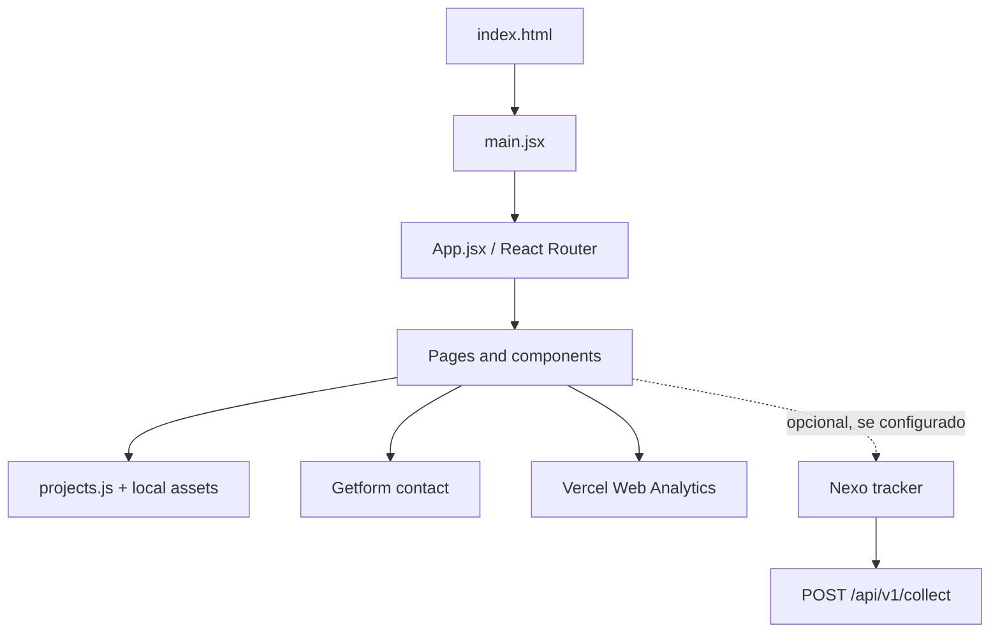

# Luca Toniolo — 3D × Code Portfolio

Portfólio web responsivo para apresentar projetos selecionados de modelagem 3D, desenvolvimento web, programação e design digital.

**Site:** https://luca-toniolo.vercel.app/

## Arquitetura

A aplicação é uma SPA em React/Vite. O React Router organiza a navegação; o catálogo de projetos e os assets são mantidos no próprio repositório, sem CMS ou banco de dados para o conteúdo.



```text
src/
├── App.jsx / main.jsx         # entrada e composição
├── components/                # layout, seções e componentes de interface
├── data/projects.js           # catálogo e metadados dos projetos
├── assets/                    # imagens dos projetos
└── lib/
    ├── analytics.js           # inicialização do tracker opcional
    ├── nexo-tracker.js        # coleta de eventos no navegador
    └── analytics-path.js      # normalização de caminhos
public/
├── pizzeria-wireframes.html   # protótipo interativo
├── og-image.jpg               # imagem social
└── curriculo-luca-toniolo.pdf
```

## Rotas

| Caminho | Conteúdo |
|---|---|
| `/` | apresentação, destaques, habilidades, sobre e contato |
| `/work` | índice de categorias |
| `/work/3d` | galeria 3D |
| `/work/3d/:id` | detalhe de projeto 3D |
| `/work/code` | galeria de programação |
| `/work/code/:id` | detalhe de projeto de código |

Os dados de cada projeto (status, ferramentas, descrição, galeria e estudo de caso) são definidos em `src/data/projects.js`. O status da página descreve o trabalho apresentado, não a conclusão de um sistema comercial.

## Tecnologias

- React 19, React DOM, React Router 7
- Vite 8, JavaScript e CSS
- Vercel Web Analytics
- Getform para formulário de contato
- Vitest, Testing Library, jsdom e ESLint
- Sharp para otimização de imagens

## Executar e verificar

Requisitos: Node.js e npm.

```bash
npm install
npm run dev
npm test
npm run lint
npm run build
npm run preview
npm run optimize:images
```

O servidor Vite usa a porta `4173` e exige que ela esteja disponível. A otimização de imagens regenera assets WebP e a imagem social.

## Analytics

Vercel Web Analytics é separado do tracker Nexo. O tracker próprio envia eventos para `POST /api/v1/collect` apenas quando `VITE_NEXO_COLLECT_URL` e `VITE_NEXO_SITE_ID` estão configuradas e as condições de execução permitem coleta. O payload usa nomes de eventos controlados e caminhos permitidos; não envia valores de formulário, query strings ou referenciador. Respeita Do Not Track e ignora falhas de coleta para não bloquear a interface.

**Limite de implantação:** a configuração local do tracker não ativa coleta no site publicado. Para produção, a API Nexo precisa estar acessível por HTTPS, aceitar a origem do portfólio e usar armazenamento persistente. Se as variáveis do Nexo não estiverem configuradas no ambiente de produção, o tracker próprio fica inativo; a integração Vercel Analytics é independente.

## Projetos apresentados

- **3D:** ATEM Mini Pro, Playdate Console, Coca-Cola Bottle, cena planetária e estudos de laser.
- **Em desenvolvimento:** reconstrução do Coliseu e conceito de joias Constelação Floral.
- **Front-end:** Ice Cream Panda.
- **UX/UI:** protótipo de pizzaria com seis fluxos em desktop e mobile (12 wireframes); pedidos e persistência não estão implementados.
- **Acadêmico:** exercícios Java em repositório separado.

Consulte o status de cada projeto no catálogo. Galerias e wireframes são demonstrações, não prova de funcionalidades de produção.

## Implantação

Preparado para Vercel a partir da raiz do repositório. O roteamento do lado do cliente precisa de rewrite para `index.html`. `VITE_SITE_URL` define a origem pública usada nos metadados do site.

Variáveis prefixadas com `VITE_` ficam disponíveis no bundle do navegador; não coloque nelas valores privados. Para detalhes do tracker, veja o README do [Nexo Analytics](https://github.com/Lvc4br/nexo-analytics).

**Autor:** Luca Toniolo — [GitHub](https://github.com/Lvc4br) · [LinkedIn](https://linkedin.com/in/luca-toniolo)
