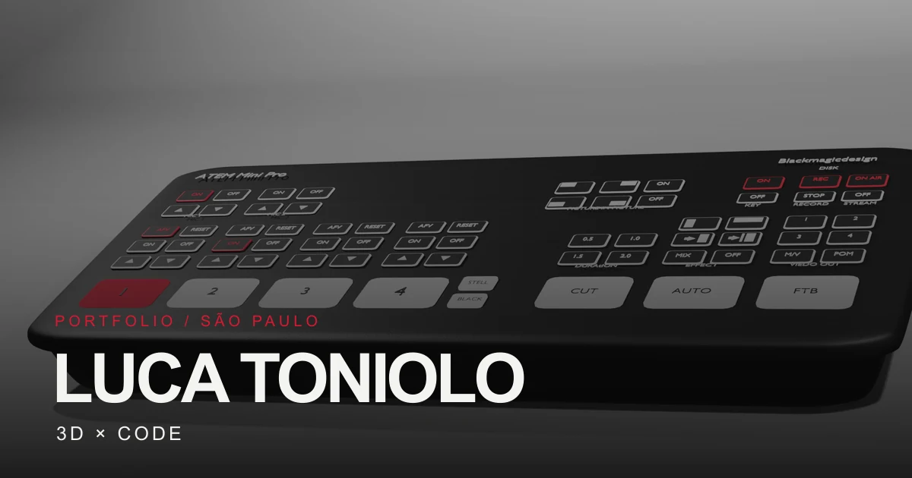

# Luca Toniolo — 3D × Code Portfolio

A React/Vite portfolio presenting selected 3D and programming projects.



## Run

```bash
npm install
npm run dev
```

## Build

```bash
npm run build
```

## Optimize images

```bash
npm run optimize:images
```

This creates metadata-free WebP versions of the portfolio images and a 1200 × 630
social preview at `public/og-image.webp`.

## Project content

Project information is maintained in `src/data/projects.js`. The Colosseum and jewelry
projects are in progress; their construction process and renders will be added as they
are ready.

## Deploy on Vercel

The app is served from `/`, with `vercel.json` rewriting client-side routes to `index.html`.
Set `VITE_SITE_URL` in the Vercel project environment variables and redeploy whenever the
public domain changes. The same value is used for the canonical URL, `og:url`, and absolute
Open Graph and Twitter preview image URLs.

For local builds, copy `.env.example` to `.env` and set `VITE_SITE_URL` to the desired
HTTPS origin without a trailing slash.

Main routes:

- `/` — Home
- `/work` — Work
- `/work/3d` — 3D
- `/work/3d/:id` — 3D project detail
- `/work/code` — Code
- `/work/code/:id` — Programming project detail
